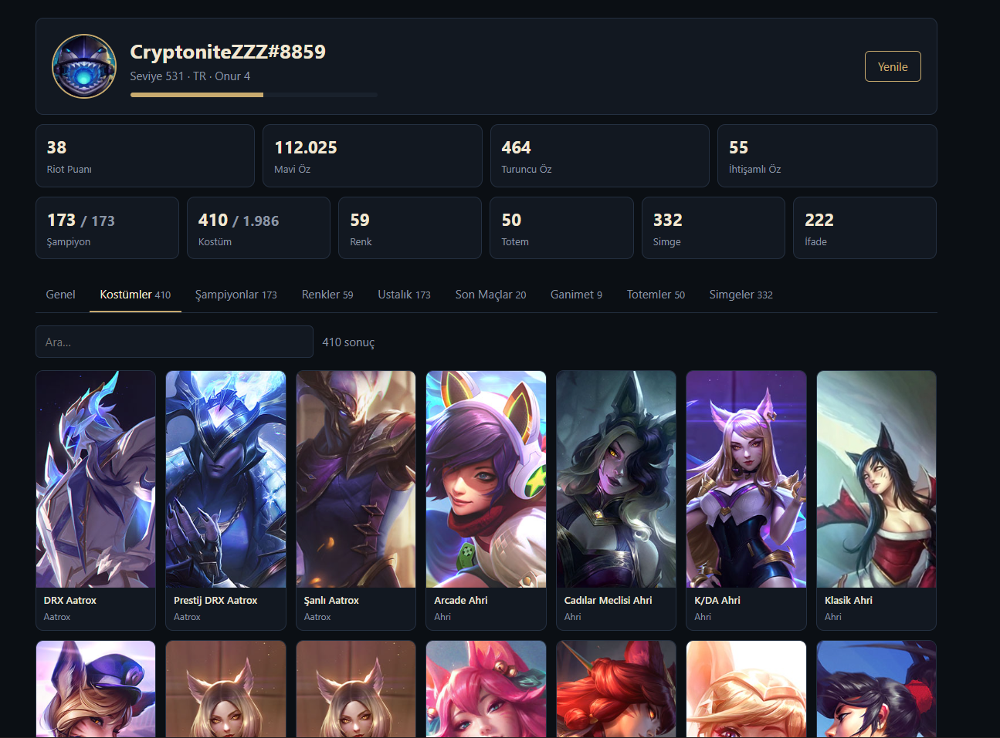

# LoL Account Viewer

A small local web app that shows everything about your own League of Legends account in one place: champions, skins, chromas, ranks, wallet, mastery, loot, ward skins, icons and recent matches.

It reads the data straight from the League client running on your machine. You never type your password into this tool, and nothing leaves your computer.



## Features

- **Profile:** Riot ID, level and progress, region, honor level.
- **Wallet:** RP, Blue Essence, Orange Essence and Mythic Essence.
- **Ranks:** Solo/Duo, Flex and Arena with LP, win rate and last season's rank.
- **Collection:** owned champions, skins and chromas with artwork and instant search.
- **Mastery:** every champion sorted by mastery points, with level and last played date.
- **Matches:** the last 20 games with champion, queue, KDA, CS and result.
- **Extras:** loot inventory, ward skins, summoner icons and emote count.
- **Resilient:** if one endpoint fails, the rest of the page still loads and the failure is listed in the footer.
- **Auto-connect:** the page waits for the client and refreshes itself once you log in.

The UI text is in Turkish.

## Requirements

- [Node.js](https://nodejs.org) 18 or newer
- League of Legends installed and the client open with your account logged in

There are no npm dependencies.

## Quick start

```bash
git clone https://github.com/gorkdev/lol-account-viewer.git
cd lol-account-viewer
npm start
```

Open <http://127.0.0.1:5174>, then start the League client and log in. The page connects on its own.

## How it works

While the League client is running, it exposes a local REST API known as the LCU (League Client Update) API. It listens on `127.0.0.1` on a random port and is protected by a per-session password.

1. **Find the client.** The server reads the `LeagueClientUx.exe` command line to get the port and password. If that fails, it falls back to the `lockfile` in the game's install folder.
2. **Collect the data.** On each request it calls the relevant LCU endpoints in parallel and merges them into a single JSON payload at `/api/account`.
3. **Show the images.** Artwork is served by the client itself. The `/asset` route proxies only paths under `/lol-game-data/assets/`, so no other client endpoint is reachable through it.

```
Browser ──> Node server (127.0.0.1:5174) ──> League client LCU API (127.0.0.1:<random port>)
```

### Main LCU endpoints

| Data | Endpoint |
| --- | --- |
| Profile | `/lol-summoner/v1/current-summoner` |
| Ranks | `/lol-ranked/v1/current-ranked-stats` |
| Champions | `/lol-champions/v1/inventories/{summonerId}/champions` |
| Skins and chromas | `/lol-inventory/v2/inventory/CHAMPION_SKIN` + `/lol-game-data/assets/v1/skins.json` |
| Mastery | `/lol-champion-mastery/v1/local-player/champion-mastery` |
| Wallet | `/lol-inventory/v1/wallet/{currency}` |
| Loot | `/lol-loot/v1/player-loot` |
| Matches | `/lol-match-history/v1/products/lol/current-summoner/matches` |

### Counting skins correctly

The champions endpoint also lists mode-specific duplicates of champions, for example Ahri as both `103` and `60103`. Counting skins from it inflates the total.

Instead, owned skins are taken from the `CHAMPION_SKIN` inventory and matched against the client's skin catalog. This gives the same number as the in-game Collection tab. Duplicate champions with an id of 10000 or more are excluded from the champion list.

## Configuration

| Variable | Description | Default |
| --- | --- | --- |
| `PORT` | Port of the web UI | `5174` |
| `LOL_DIR` | League install folder, if it is not in a default location | `C:/Riot Games/League of Legends` |
| `LCU_PORT`, `LCU_PASSWORD` | Connect to the client with explicit credentials | auto-detected |

Example:

```bash
PORT=8080 LOL_DIR="D:/Games/League of Legends" npm start
```

## Project structure

```
├── server.js       HTTP server: UI, /api/account and the asset proxy
├── account.js      Calls LCU endpoints and builds the account payload
├── lcu.js          Finds the client's port and password, performs requests
└── public/
    ├── index.html
    ├── app.js      Rendering, tabs, search and auto-reconnect
    └── style.css
```

## Security

- The server binds to `127.0.0.1` only, so other devices on your network cannot reach it.
- Only `GET` requests are accepted. The tool never buys, changes or sends anything.
- The image proxy rejects every path outside the game asset folder.
- The client password is kept in memory and never written to disk or logged.

## Troubleshooting

| Message | Fix |
| --- | --- |
| League client is not running | Open the League client, not only the Riot Client. |
| Client is open but not logged in | Log in to your account. The page refreshes by itself. |
| Champion inventory is not loaded yet | Wait a few seconds after login. The page retries automatically. |
| A section is listed under "unavailable data" | That endpoint changed in a client update. The rest of the page still works. |

## Disclaimer

LoL Account Viewer isn't endorsed by Riot Games and doesn't reflect the views or opinions of Riot Games or anyone officially involved in producing or managing Riot Games properties. Riot Games, and all associated properties are trademarks or registered trademarks of Riot Games, Inc.

The LCU API is not officially supported by Riot. Endpoints can change with any client patch.
